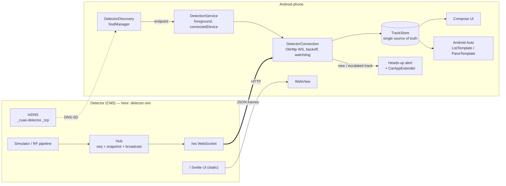

# Detector Link — concept demo

A working proof of concept for the first task in the job posting: an Android app that

1. **finds the detector on the local network via mDNS**,
2. **keeps a WebSocket open and receives detections in real time, also in the background**,
3. **shows the current detections on Android Auto**,
4. **shows the detector's own Svelte frontend inside the app**.

I don't have your detector, so the repo includes a **Rust simulator** that behaves like one:
it advertises itself over mDNS, streams simulated drone tracks over WebSocket and serves a Svelte UI.
That makes the whole chain demoable on one laptop and one phone.

```
droneward_proj/
├── detector-sim/   Rust · axum + tokio + mdns-sd · the "detector"
├── frontend/       Svelte 5 + Vite · stand-in for the UI hosted on the device
└── android/        Kotlin · Compose · OkHttp · Car App Library
```

## Architecture



One process, one connection, one `TrackStore`. The phone UI, the foreground service and the car
screen all observe the same `StateFlow`, so phone and car can never disagree about what's in the air.

## Quick start

```bash
# 1. Build the web UI (served by the simulator)
cd frontend && pnpm install && pnpm build

# 2. Run the detector simulator: advertises over mDNS, listens on :8080
cd ../detector-sim && cargo run --release
#    → open http://127.0.0.1:8080, press "Simulate drone"

# 3. Android: open android/ in Android Studio, run on a phone on the same Wi-Fi
```

| Where the app runs | How it finds the simulator |
|---|---|
| Real phone, same Wi-Fi as the laptop | mDNS: "Detector SIM-01" appears in the list |
| Android emulator | Emulator NAT drops multicast, so use manual entry `10.0.2.2:8080` |

**Android Auto (DHU):** SDK Manager → install *Android Auto Desktop Head Unit Emulator* →
on the phone open Android Auto settings, tap *Version* 10× → ⋮ → *Developer settings* →
enable *Unknown sources* → ⋮ → *Start head unit server* →
`adb forward tcp:5277 tcp:5277` → `$ANDROID_SDK/extras/google/auto/desktop-head-unit`.

Useful simulator flags: `--port`, `--name`, `--seed` (deterministic traffic), `--tick-ms`, `--no-mdns`.
`POST /api/spawn` makes a drone appear immediately (handy live in an interview).

## Demo script (≈5 min)

1. **Discovery.** Start the sim, open the app: the detector shows up by name, no IP typed.
   `Ctrl+C` the sim: it sends an mDNS goodbye and disappears from the list immediately.
2. **Live stream.** Connect. Status goes *Connecting → Live*, tracks appear sorted by threat,
   then distance. `seq` counts up.
3. **Background.** Lock the phone. Hit *Simulate drone* in the browser: heads-up alert on the lock screen.
4. **Resilience.** Kill the sim for 10 s and restart it. The app shows *Reconnecting*, keeps the
   last tracks marked **STALE**, then resyncs from a fresh snapshot without re-alerting known tracks.
5. **Android Auto.** In the DHU: live list with threat-tinted icons, tap a row for details.
   A new drone raises a heads-up on the car screen.
6. **Detector UI.** *Open detector UI*: the Svelte radar, the same build a laptop browser gets.

## Protocol (v1)

Server → client JSON text frames, tagged by `type`. Source of truth: `detector-sim/src/protocol.rs`,
mirrored in `android/.../model/Protocol.kt`.

| type | when | payload |
|---|---|---|
| `hello` | first frame | `protocol`, `detector {id, name, firmware, position}` |
| `snapshot` | second frame; again after server-side lag | `seq`, `ts_ms`, `tracks[]` |
| `track_update` | track new or changed | `seq`, `track` (upsert by id) |
| `track_lost` | track timed out | `seq`, `ts_ms`, `id` |
| `heartbeat` | every 2 s | `seq`, `ts_ms`, `active` (track count) |

**Consistency rule:** every stateful frame carries a global `seq`. The snapshot and the client's
broadcast subscription are taken under the same lock the publisher holds, so after a snapshot
with `seq = N` the client receives exactly `N+1, N+2, …`. Any gap, or a heartbeat whose `active`
count disagrees with local state, means "I'm out of sync": the client reconnects and the server
always opens with a fresh snapshot. No replay buffers, no "since seq N" API, no partial-state bugs.

**Compatibility rule:** clients ignore unknown fields, unknown enum values become `UNKNOWN` and
unknown message types are dropped. `protocol` (also in the mDNS TXT record) changes only on breaking
changes, and the app filters out detectors with an incompatible major version at discovery time.

mDNS TXT records: `id=<serial> proto=1 ws=/ws ui=/`. Paths come from the device, so firmware can
move them without an app update.

## Decisions and the traps they avoid

**Discovery: `NsdManager`, not jmDNS.** The system mDNS daemon does the multicast, so no
`MulticastLock` and no fight over port 5353, and it keeps working in the background.
Handled quirks: callbacks arrive on binder threads (funnelled into one channel and processed
sequentially), pre-API-34 `resolveService` allows only one resolve in flight (serialised),
and resolves can hang (5 s timeout). IPv4 is preferred because link-local IPv6 needs scope IDs.

**The no-internet Wi-Fi trap.** In the field the detector will likely be its own access point
without internet. Android then keeps mobile data as the default network, so a socket to
`192.168.x.x` silently goes out over LTE. `WifiBinding` tracks the Wi-Fi network without requiring
`NET_CAPABILITY_INTERNET` and binds the process to it. That also covers the WebView, which has no
per-network socket factory.

**Background delivery.** Foreground service of type `connectedDevice` (the detector *is* a
connected device; `dataSync` would hit Android 15's 6-hour daily cap). A partial wake lock is held
only while connected, since alerts are safety-relevant and the phone in a car is usually charging.
The Wi-Fi lock keeps latency low. OkHttp pings every 10 s, and a heartbeat watchdog kills the socket
after 6 s of silence (dead Wi-Fi often looks alive to TCP). Exponential backoff with jitter, and an
immediate retry when the link is fine but just out of sync.

**Alerts.** Fired on a *new* track or a threat *escalation*, never on every update, and never
again for tracks already known after a reconnect. One notification per track id, so an escalation
replaces the earlier alert instead of stacking. `CarAppExtender` makes the same notification a
heads-up on the car screen, and tapping it there opens the car app.

**Android Auto is a policy problem as much as a code problem.**
- Category `androidx.car.app.category.IOT`, which requires Car API level 6 (`minCarApiLevel=6`).
- Templates have a step quota. The title is constant, so updates count as *refreshes*. Whether a
  changing *row count* is also a refresh depends on the host's "adaptive task limits" feature.
  **This is the first thing I'd verify on real head units**; the fallback is fixed-size slots.
- Row count is capped by `ConstraintManager` (the host decides), and redraws are throttled to 1/s.
  A list that jumps every 500 ms is a distraction, not information.
- Stale data stays visible but labelled. A blank screen at the moment the link drops is the worst UX.

**WebView.** Navigation is locked to the detector's origin (anything else opens in the browser).
No JS bridge, because the UI must stay the same build a laptop browser gets. The WebView is paused
with the activity, there's a native error/retry screen, and a dark background so it doesn't flash white.

**Cleartext.** The device serves plain HTTP by IP, and `domain-config` can't match IP ranges, so
cleartext is allowed app-wide (the app talks to nothing else). For production I'd propose TLS with
a per-device certificate pinned at pairing time, plus a pairing token on `/ws`.

**Rust side.** Messages are serialised once and shared as `Arc<str>` across all clients. A slow
client that lags the broadcast channel gets a fresh snapshot instead of an unbounded backlog. The
simulator is pure (`step(now_ms)`), so tests drive time instead of sleeping.

## Tests

| | what | status |
|---|---|---|
| `cargo test` | protocol shape, simulator determinism & lifecycle, hub seq contiguity, real WebSocket end-to-end | 11 passing, clippy clean |
| `TrackStoreTest` | snapshot/delta rules, gap → resync, alerts on new/escalated only, sorting, unknown-field tolerance | 8 passing* |
| replay | 40 real frames captured from the running simulator fed through `TrackStore`: no false resyncs, heartbeat counts match | passing* |

\* Run on the JVM against the same source files. The full Android module (service, NSD, Car App,
Compose) was written without an Android SDK on the build machine and **has not been compiled yet**.
First step on a dev box: open in Android Studio, build, run on a device.

## What I'd ask the team

- Does the real detector give **bearing / range**, or only signal + protocol? (Changes the car UI the most.)
- Is the detector its own **AP**, a client on the vehicle's hotspot, or both?
- Is there an existing **WebSocket protocol** on the device? This one is a proposal; I'd adapt the
  client to the real one rather than the other way round.
- **Auth/TLS** expectations, and whether multiple phones per detector is a real scenario.
- Distribution: **Play Store** (IOT category review) or managed/sideloaded? Also, is
  Android Automotive OS (built-in, no phone) on the roadmap?

## Next steps

Compile and run on a device and DHU · `registerServiceInfoCallback` on API 34+ · instrumented test
for the reconnect path · fixed-slot list fallback for Auto · Remote ID map pane · pairing + TLS ·
CI (cargo test + gradle test + pnpm build).
