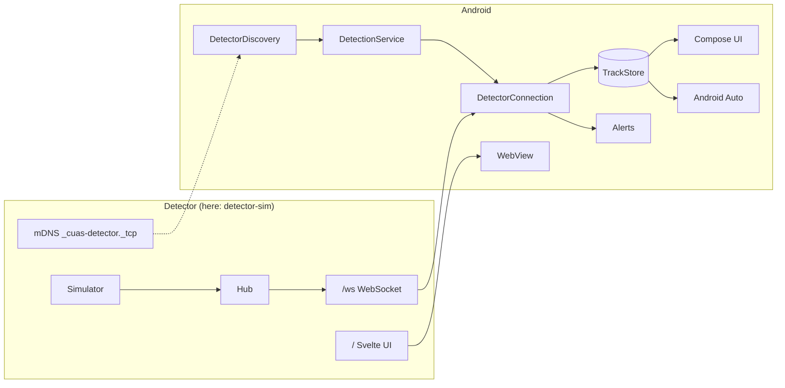

# Architecture

The phone UI, the foreground service and the Android Auto session run in one process and share
one connection and one `TrackStore`. Everything observes the same `StateFlow`, so phone and car
show the same data.

## Rust side

- `protocol.rs` - message types
- `sim.rs` - fake drone traffic; `step(now_ms)` takes the clock as input so tests don't sleep
- `hub.rs` - owns state, assigns `seq`, broadcasts frames (serialised once, shared as `Arc<str>`)
- `server.rs` - axum routes: `/ws`, `/api/info`, `POST /api/spawn`, static UI
- `mdns.rs` - advertisement; dropping it sends an mDNS goodbye

## Android side

- `discovery/` - NsdManager discovery + manual entry
- `net/` - WebSocket connection with backoff and heartbeat watchdog, Wi-Fi binding
- `data/TrackStore` - plain Kotlin, applies snapshot/delta rules, unit tested on the JVM
- `service/` - foreground service and notifications
- `car/` - Android Auto screens
- `ui/` - Compose screens and the WebView
